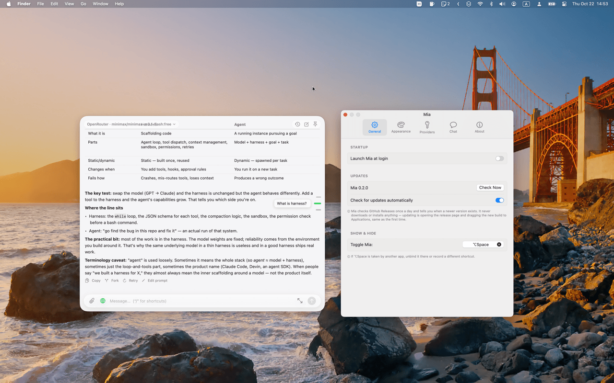

<p align="center"></p>

# Mia

[](LICENSE)


**Mia** — *Mac + intelligent assistant* — is a mini AI chat app for quick, small (and usually temporary) chats — the kind that don't need a frontier model, so it pairs nicely with lighter, locally-run ones.

Press a global hotkey (default **⌥Space**) and a floating chat panel appears with the input already focused. Pin it if you want to keep the messages as a reference for your other work.

<p align="center"></p>


## Features

- **Instant panel** — a non-activating `NSPanel`, so showing it never steals focus from the app underneath and dismissing it returns focus immediately. Remembers where you last dragged it. ⌘P pins it open across app switches, and the choice is remembered. An optional Dock icon (Settings → General) adds Mia to the Dock and ⌘Tab — switching to it reopens the panel — while the menu-bar form and the no-focus behavior stay exactly as they are.
- **Any OpenAI-compatible provider** — OpenAI, OpenRouter, or any custom endpoint, plus local models via Ollama or LM Studio (no API key needed). Switch provider and model from a pill in the panel header; long catalogs (OpenRouter ships 300+) filter as you type. Free-tier templates (Groq, Gemini, Mistral, Cerebras, NVIDIA NIM, Cohere, Hugging Face, Z AI, ModelScope, OpenCode Zen) add a provider in one click, each seeded with a popular free model — see the [free-LLM catalog](https://github.com/open-free-llm-api/awesome-freellm-apis) they are curated from.
- **Slash commands** — your own prompt templates with a `{input}` placeholder and an autocomplete popup when the draft starts with `/`.
- **Retry the last answer** — with a different model if you like: switch the pill, press Retry. *Edit prompt* puts your last message back in the composer instead, and **↑** in an empty composer walks back through prompts you've sent.
- **See the thinking** — while a reasoning model works, its thoughts scroll in a small window you can expand; once the answer lands they fold into a collapsed *Reasoning* section above it.
- **Question timeline** — a quiet row of bars on the transcript's right edge, one per question. Hover to magnify them Dock-style and preview the question; click to jump straight to it. The column rests at low opacity and dims further after you leave.
- **Search your chats** — ⌘Y searches what was actually said, not just chat titles, and shows the matching line.
- **Large editor** (⌘E) — the input capsule morphs into a full draft editor; ⌘↩ sends.
- **Liquid-glass look** on macOS 26 (translucent panel with an adjustable tint), a solid fallback below that, Light/Dark/Auto appearance, four accent presets plus a custom color picker, and full support for Reduce Motion / Reduce Transparency.
- **Ask about any selection** — select text in any app and a small floating button appears below it; click to quote the selection into the panel (an "Ask Mia About Selection" service is also available for keyboard-driven flows). Needs Accessibility access — grant it from Settings › Chat.
- **Personas** — switch the system prompt between presets (Translate, Code Review, Writing, or your own) from Settings › Chat; Custom keeps the free-text prompt untouched.
- **Auto-named chats** — after a reply lands, the current provider is asked once (≤24 tokens) for a short title. Toggle it in Settings › Chat.
- **Turn-cost stats** — the reply footer shows what each answer cost: `62518 tokens · 5m 42s · 51.2 tok/s`. Total tokens include the prompt (the cost-facing number); the rate divides output tokens by the network time, so a tool-heavy turn dilutes it. Works on every provider path — OpenAI-compatible (`stream_options.include_usage`), Codex app-server, and the ChatGPT backend; a provider that reports no usage falls back to duration alone. No toggle — it just sits in the footer.
- **Background notifications** — the panel hides whenever you click away, so a reply finishing elsewhere would go unnoticed. Turn it on in Settings › General and a banner (plus optional sound) marks every turn that finishes or fails; click the banner to reopen the panel. Off by default.
- **Queue a follow-up while the reply streams** — Enter during generation parks your next question as a chip above the input (a second Enter replaces it). ✕ drops it; ↑ inserts it under the streaming answer without disturbing the turn, and it is answered automatically the moment the turn truly ends — Stop included.
- **Export your chats** — right-click a chat in the ⌘Y history popover for Markdown or JSON, or Export All to a folder; a way out before the 50-chat storage cap prunes anything. A single reply exports too: the footer's Export button (next to Copy/Fork) saves that answer as Markdown, reasoning included.

## Install

Download the latest `Mia-x.y.z.dmg` from [Releases](https://github.com/imdlan/mia-desktop/releases), open it, and drag Mia to Applications. Releases are Developer-ID signed and notarized, so macOS opens them without any Gatekeeper warning.

Requires **macOS 14 or later**. The liquid-glass backdrop needs macOS 26; older systems get a solid panel.

### Upgrading from PopChat

Mia is the renamed PopChat. On first launch it migrates everything automatically — providers, API keys, conversations, personas, slash commands, settings, and your global hotkey. Nothing is deleted; the old `PopChat` data stays in place until you remove it yourself. Because the bundle identifier changed, macOS asks you to **re-grant Accessibility access once** (Settings › Chat) if you use the selection button or the Services item.

## Build from source

Needs a Swift toolchain — Xcode, or just the Command Line Tools (`xcode-select --install`).

```sh
git clone https://github.com/imdlan/mia-desktop.git
cd mia-desktop
./build.sh              # release build → dist/Mia.app
open dist/Mia.app
```

`./build.sh debug` builds the debug configuration. The script wraps the SwiftPM binary in an app bundle and ad-hoc signs it by default — fine for a build you made yourself, and you can point `MIA_SIGN_IDENTITY` at your own certificate instead. `./release.sh` is the release path — it signs with a Developer ID and notarizes with a locally stored `notarytool` keychain profile: put the profile name in `.notary-profile` (git-ignored) or pass `MIA_NOTARY_PROFILE`.

There is no Xcode project — it's plain SwiftPM (`Package.swift`) plus `build.sh`.

## Setup

Open Settings from the menu bar icon or **⌘,** inside the panel.

- **Providers** — pick a preset or add a custom OpenAI-compatible endpoint, paste an API key, and fetch the model list. **Add Provider…** also offers a *Free tiers* section (Groq, Google Gemini, Mistral, Cerebras, NVIDIA NIM, Cohere, Hugging Face) that fills in the right base URL and links where to get a key. ChatGPT-subscription access has two separate presets:
    - *OpenAI (Codex app-server)*: preferred. You must install and update Codex yourself, run `codex login` in Terminal, and ensure Mia can find the `codex` executable (an explicit path field is available). Mia only starts the local app-server; it does not install Codex or own/copy its login.
    - *OpenAI subscription (unofficial)*: the existing direct OAuth flow. It opens your browser and needs port 1455 during sign-in. Because it calls a backend not documented for third-party apps, it may break and may carry account or terms risk.
- **Chat** — edit the system prompt, define slash commands, pick a persona, and choose the web-search engine (Tavily/Brave need keys, DuckDuckGo doesn't). The Selection section configures the floating selection button (enable, send-immediately, and the Accessibility status it depends on).
- **Show & Hide** (Settings › General) — record whatever global shortcut you want (⌥Space by default); the menu bar menu shows the current one next to *Toggle Mia*.
- **Notifications** (Settings › General) — off by default. When on, a banner and an optional sound mark turns that finish (or fail) while Mia isn't frontmost; clicking the banner reopens the panel. If banners never appear, check that Mia's notification style in System Settings › Notifications is set to Banners or Alerts and no Focus mode is on — a silent delivery still lands in Notification Center, and the sound plays either way.

Mia checks GitHub Releases once a day and tells you in Settings › General (and in the menu bar icon's menu) when a newer version exists. It never downloads or installs anything — you update by opening the release page and dragging the new build to Applications, the same way you installed it. Turn the check off in Settings › General.

Local models need no key at all: run Ollama and pick its preset, or point a custom endpoint at LM Studio's server.

### Where things are stored

| What | Where |
| --- | --- |
| Providers, models, preferences | `UserDefaults` (`app.tapfun.mia`) |
| API keys & OAuth tokens | `~/Library/Application Support/Mia/secrets.json` (chmod 600) |
| Conversations | `~/Library/Application Support/Mia/conversations/*.json` |

Secrets are a plain JSON file, not the Keychain: builds from source are ad-hoc signed, so every rebuild changes the binary identity, and macOS would then demand the login-keychain password on every launch. The file matches the trust model of the `.env` the keys usually come from.

## Keyboard shortcuts

| | |
| --- | --- |
| ⌥Space | show / hide the panel (recordable) |
| Esc | hide the panel |
| ⌘N | new chat |
| ⌘Y | history popover (↑/↓ select, ↩ open, ⌘⌫ delete) |
| ⌘F | find in chat (↑/↓ or ⌘G/⇧⌘G to step, ⎋ to close) |
| ⌘E | large draft editor (⌘↩ sends) |
| ⌘P | pin the panel open |
| ⌘, | Settings |
| ↩ / ⇧↩ | send / newline |
| ↑ / ↓ | recall prompts you've sent (empty composer only) |

## Development

`./build.sh debug` produces `.build/debug/Mia`, which doubles as a headless test harness — there is no XCTest suite, the `--smoke-*` flags are the test suite:

```sh
MIA_API_KEY=… .build/debug/Mia --smoke              # live streaming round-trip
.build/debug/Mia --smoke-typing                         # composer latency budget
.build/debug/Mia --smoke-find                           # find-in-chat behavior
```

A dozen more cover attachments, persistence, providers, prompt recall, cross-chat search, reasoning, the typewriter reveal and the Codex app-server transport (against fake fixtures, so they cost no subscription quota). See [CONTRIBUTING.md](CONTRIBUTING.md) for the full list, the rules for running them, and the performance constraints to respect when changing the transcript or composer.

## License

MIT — see [LICENSE](LICENSE).

## Acknowledgments

Mia is a renamed and continued fork of [PopChat](https://github.com/lec77/PopChat) by [Le Chen](https://github.com/lec77), used and re-released under the [MIT License](LICENSE). Many thanks for the original work.

## Status

Version 0.6.0 — built for personal use and shared as-is. Out of scope by design: model-controlled code execution, arbitrary tool plugins, voice, multi-window.

The direct ChatGPT-subscription path is unofficial and potentially risky; it is retained for existing users but may break or conflict with account/usage terms. The preferred alternative delegates to the user's own Codex installation through the experimental `codex app-server` protocol. That path requires the user to install, authenticate, and maintain Codex, and may need compatibility updates as the protocol evolves.
